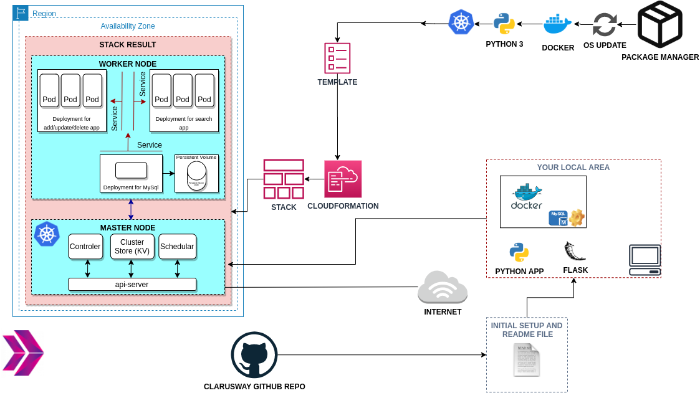
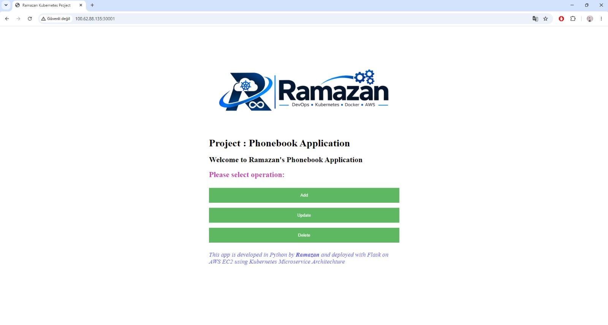
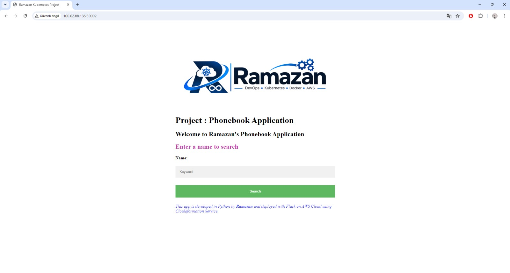

# Kubernetes Microservice Phonebook

A phonebook application deployed on Kubernetes on AWS EC2. The project uses two independent Python Flask services and a shared MySQL database. The webserver handles creating, updating, deleting, and listing contacts; the resultserver provides contact search.

## Architecture



- **Webserver** — Flask application for phonebook operations (NodePort `30001`).
- **Resultserver** — Flask application for searching contacts (NodePort `30002`).
- **MySQL** — Shared database, exposed internally as `mysql-svc:3306`.
- **Persistent storage** — MySQL data is stored through `mysql-pvc` and `mysql-pv`.

Both Flask services read their database connection settings from `servers-configmap` and credentials from the Kubernetes Secret named `shared-secret`.

## Application screenshots

The following screenshots are intended to show the application running in a browser after deployment. Save the actual screenshots in `outputs_after_deploy/` using these filenames; the images will appear here once they are added to the repository.

### Webserver — phonebook application



### Resultserver — contact search



> Screenshots should show the working application, but hide public IPs, credentials, and any personal contact data before uploading.

## Repository structure

```text
.
├── image_for_web_server/
│   ├── Dockerfile
│   ├── app.py
│   ├── requirements.txt
│   ├── templates/
│   └── static/
│       └── images/
│           └── ramazan-logo.png
├── image_for_result_server/
│   ├── Dockerfile
│   ├── app.py
│   ├── requirements.txt
│   └── templates/
├── outputs_after_deploy/
│   ├── webserver_output.png
│   └── resultserver_output.png
├── mysql-deploy.yaml
├── mysql-pv.yaml
├── mysql-pvc.yaml
├── mysql-svc.yaml
├── servers-configmap.yaml
├── webserver-deploy.yaml
├── webserver-svc.yaml
├── resultserver-deploy.yaml
├── resultserver-svc.yaml
├── Microservice_structure.png
└── README.md
```

## Docker images

The application images are published on Docker Hub under the `ramznagc` account.

- Webserver: `ramznagc/web-server:1.0.2`
- Resultserver: `ramznagc/result-server:1.0.1`

Build and push the images from the project root:

```bash
docker build -t ramznagc/web-server:1.0.2 ./image_for_web_server
docker build -t ramznagc/result-server:1.0.1 ./image_for_result_server

docker login
docker push ramznagc/web-server:1.0.2
docker push ramznagc/result-server:1.0.1
```

## Deploy to Kubernetes

Make sure `kubectl` is connected to the target cluster. Before applying the application Deployments, create the Kubernetes Secret named `shared-secret` with the credential keys required by the manifests. Do not commit real Secret values to GitHub. The file `k8s/shared-secret.yaml`, if present locally, is intentionally excluded from version control.

Apply the resources from the project root:

```bash
kubectl apply -f mysql-pv.yaml
kubectl apply -f mysql-pvc.yaml
kubectl apply -f servers-configmap.yaml
kubectl apply -f mysql-svc.yaml
kubectl apply -f mysql-deploy.yaml

kubectl apply -f resultserver-deploy.yaml
kubectl apply -f resultserver-svc.yaml
kubectl apply -f webserver-deploy.yaml
kubectl apply -f webserver-svc.yaml
```

Check the rollout and Kubernetes resources:

```bash
kubectl get pods -o wide
kubectl get deployments
kubectl get services
kubectl get pvc
```

When the pods are ready, open the NodePort URLs using the public IP address of a node that is reachable from your browser:

```text
http://<NODE-PUBLIC-IP>:30001   # Webserver
http://<NODE-PUBLIC-IP>:30002   # Resultserver
```

Allow inbound TCP traffic on ports `30001` and `30002` in the AWS EC2 Security Group. Do not use the example placeholder as a real IP address.

## Configuration and persistent data

- MySQL database: `phonebook`
- MySQL service: `mysql-svc:3306`
- Database host and non-sensitive settings: `servers-configmap`
- Database credentials: Kubernetes Secret `shared-secret`
- Persistent Volume capacity: `20Gi`
- Access mode: `ReadWriteOnce`
- Current PV host path: `/mnt/data`
- Current PV node affinity: `kube-worker`

**Important:** The current PersistentVolume uses a node-local `hostPath` on the worker node. A deployment on another cluster or a different worker requires the data directory and PV configuration to be prepared for that environment. Do not delete or reinitialize `/mnt/data` when redeploying, because it contains the persisted MySQL database.

## Security notes

- Kubernetes Secret values must not be committed to this public repository. Base64 encoding is not encryption.
- Replace example values with your own credentials when deploying.
- Review screenshots before uploading and remove credentials, public IPs if you do not want to disclose them, and real personal contact information.
- The NodePort ports must be opened only as required by your deployment environment.
